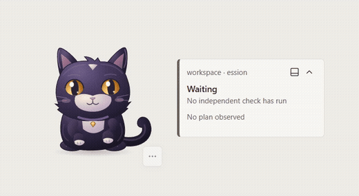
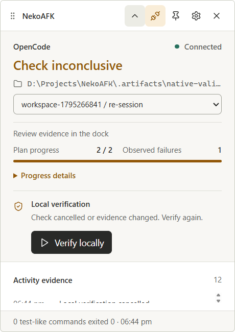
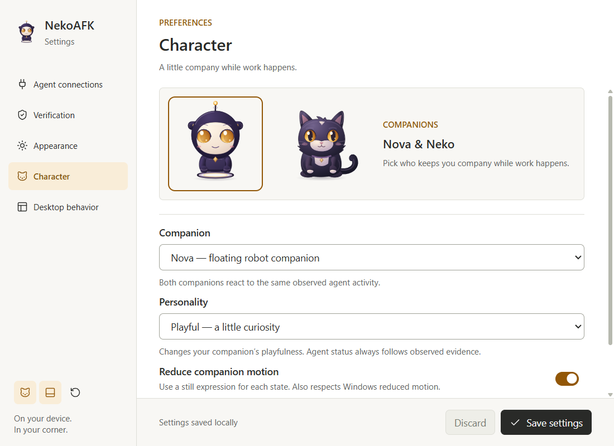

# NekoAFK

A lightweight, privacy-first desktop companion and real-time telemetry HUD for local AI coding agents on Windows. Built with Tauri 2, Rust, and TypeScript.

---

## Live Demonstration

<div align="center">
  
  
  <p><em>Left: Articulated vector companion reacting to live agent events &middot; Right: Real-time progress HUD tracking agent plan steps</em></p>
</div>

---

## Visual Preview

| Desktop Companion (Neko) | Telemetry Dock | Preferences & Settings |
|:---:|:---:|:---:|
|  |  |  |

| Active Editing / Typing | Tool Inspection Mode | Verified Celebration |
|:---:|:---:|:---:|
|  |  |  |

---

## Key Features

- **Articulated Vector Companions**: Select between **Neko** (midnight cat) or **Nova** (floating robot). Each companion features 11 authored acting states driven by real-time agent telemetry.
- **Zero-Network IPC**: Relies entirely on an atomic filesystem spool queue. No open TCP ports, no background web servers, and zero API keys.
- **Live Progress HUD**: Compact, docked overlay tracking active tool execution, agent plan steps, and elapsed duration.
- **Detachable Telemetry Dock**: Inspect active tools, error streaks, execution history, and live verification logs directly on desktop.
- **Double-Fingerprint Local Verification**: Independent test runner sandboxed inside a Windows Job Object. Verifies exit codes and source fingerprints before allowing celebration.
- **Hardware-Accelerated UI**: Full support for 60Hz to 144Hz+ displays with composited SVG animations, dark mode, and procedural audio chimes via Web Audio API.

---

## Supported Agent Integrations

NekoAFK connects locally with modern AI development environments:

| Agent / IDE | Integration Mode | Bridge Script |
|:---|:---|:---|
| **OpenCode** | Native Plugin | `.opencode/plugins/nekoafk.js` |
| **Google Antigravity** | Workspace Bridge | `integrations/antigravity/nekoafk-antigravity.mjs` |
| **Claude Code** | CLI Bridge | `integrations/claudecode/nekoafk-claude.mjs` |
| **Cursor** | Composer / Agent Bridge | `integrations/cursor/nekoafk-cursor.mjs` |
| **Windsurf** | Cascade Bridge | `integrations/windsurf/nekoafk-windsurf.mjs` |
| **OpenAI Codex** | CLI Bridge | `integrations/codex/nekoafk-codex.mjs` |
| **Zai** | Agent Bridge | `integrations/zai/nekoafk-zai.mjs` |

---

## Quickstart

### Prerequisites

- Windows 10 or 11 (64-bit)
- Node.js (v18+)
- Rust toolchain (stable MSVC)
- Microsoft Edge WebView2 runtime (standard on Windows 10/11)

### Development

```powershell
# Install frontend dependencies
npm ci

# Start desktop application in development mode
npm run desktop
```

### Production Build

```powershell
# Compile TypeScript frontend and native binary
npm run build
npx tauri build --no-bundle
```

The compiled release executable will be located at:
`src-tauri/target/release/nekoafk.exe`

---

## Privacy & Safety Model

1. **No Sensitive Data Leaks**: Prompts, file contents, terminal output, and LLM responses are never forwarded to the companion. Only sanitized event classifications (`editing`, `testing`, `planning`, `permission`) are dispatched.
2. **Deterministic Verification**: Agent completion claims are treated as unverified candidates until an independent local check command (such as `npm test` or `cargo test`) exits cleanly with code 0 and an unchanged source fingerprint.
3. **Sandboxed Child Processes**: All test executions run strictly inside an OS-level Windows Job Object with process lifetime limits.

---

## Test Suite

```powershell
# Execute JavaScript unit tests (21 tests)
npm test

# Execute Rust native tests (42 tests)
cargo test --manifest-path src-tauri/Cargo.toml
```

---

## License

This project is licensed under the MIT License. See [LICENSE](LICENSE) for details.
